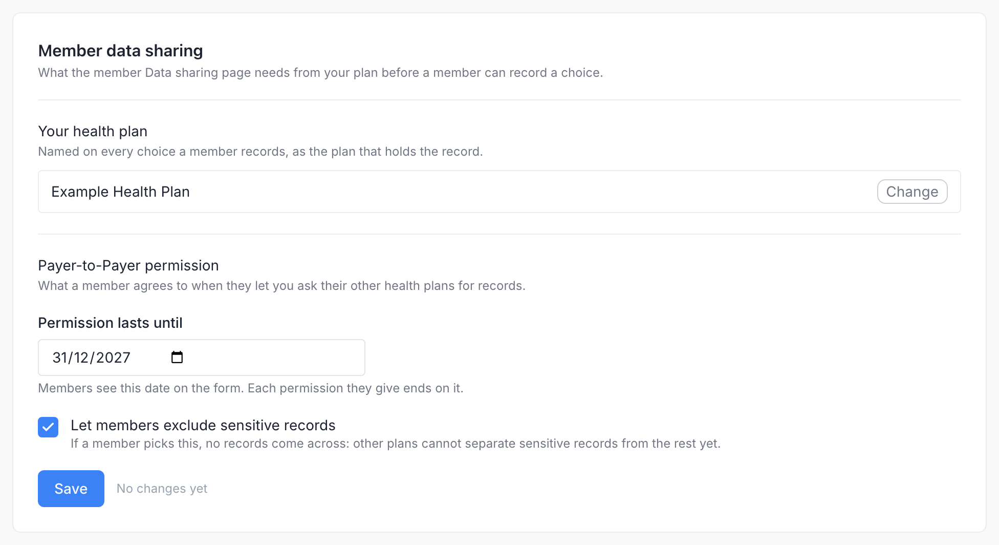
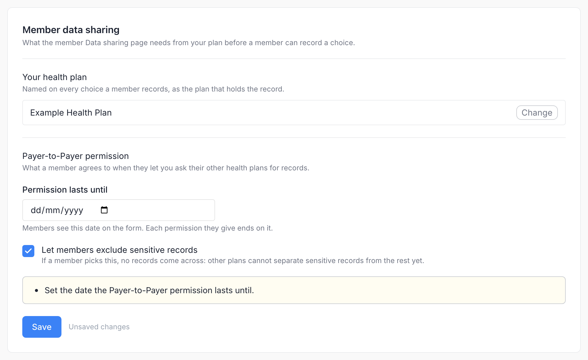
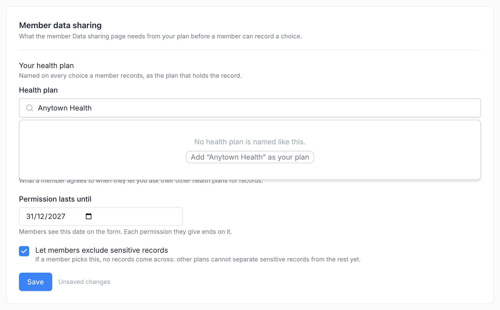
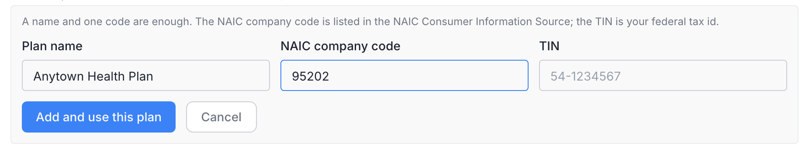
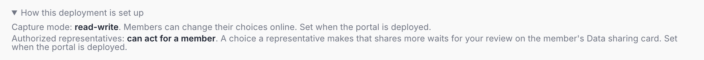

# Consent Settings

The **Settings → Consent** tab of the Admin Portal sets what the member portal's [Data sharing page](member-portal/consent-panel.md) needs from your plan before a member can record a choice, and which health plans members can name for Payer-to-Payer exchange.

Open **Settings → Consent** (`/dashboard/settings/consent`). The tab is shown only on deployments that enable the Consent Panel. It is written for the plan's administrator: plans are shown by name, and no record ids, profile names or deployment variables appear on it.

## Member data sharing

The first card holds the three settings and its own **Save** button.

| Setting | What to enter |
|---|---|
| **Your health plan** | The `Organization` record that stands for your plan. Every choice a member records names it as the plan that holds the record (`Consent.organization`, the disclosing or receiving payer, and the custodian of the consent document). A set plan is shown by name with **Change**; the picker lists plans by name as you type, and *Your plan: <name>* confirms the pick. The record must declare the HRex Organization profile without a version (`http://hl7.org/fhir/us/davinci-hrex/StructureDefinition/hrex-organization` in `meta.profile`); otherwise members' saves are refused. |
| **Permission lasts until** | The date every new Payer-to-Payer permission ends. HRex requires an end date on the opt-in: the member sees it on the form before saving, and the record carries it as `provision.period.end`. It cannot be in the past. A change applies to permissions given afterwards; ones already on file keep their date. |
| **Let members exclude sensitive records** | Whether the form offers *Only non-sensitive information*. Until sensitive data is labeled, a member who picks it is returned to other plans as consent-constrained and no records come across; the form warns the member before they save. |

**Save** is always enabled. A press with something missing lists the problems above the button instead of saving, for example *Set the date the Payer-to-Payer permission lasts until.*, *The end date has passed. Set a date in the future.* or *The health plan was not found. Pick it from the list.*; a press with nothing changed says *Nothing changed*; a save confirms with *Settings saved*. The settings are stored on the admin Aidbox and read by the next save on the member page; no restart is needed.

Members can save choices only while the settings are complete: the plan is set and exists, and the end date is set and has not passed. While they are not, a yellow note at the top of the card says what is missing, for example *Members cannot record choices yet: pick your health plan; set the date the Payer-to-Payer permission lasts until.* or *… the Payer-to-Payer end date 2026-01-01 has passed, set a new one.*, and the member page shows the choices on file but an opened form says the change cannot be made online yet. The note disappears once all three are in order.

### Add your plan

The plan's Organization usually arrives with the plan's data. When it does not, the picker finds nothing and offers to create it:

**Add “<name>” as your plan** (or **Add your plan** under the picker) opens a form for the **Plan name** and at least one of the two codes, the **NAIC company code** (five digits, as listed in the NAIC Consumer Information Source) or the **TIN** (the plan's federal tax id, nine digits, `XX-XXXXXXX`; the hyphen may be left out). Health plans have no NPI: it identifies providers.

**Add and use this plan** creates the `Organization` (HRex Organization profile, typed as a payer, the codes as its identifiers) and sets it as your plan in the same step; the date and the sensitive-records option stay as they were. The new plan is never offered to members on the Payer-to-Payer form. A press with something missing lists it above the button, for example *Enter the NAIC code or the TIN. One is enough.*

One plan, one record: if an `Organization` already carries the code — loaded by a data feed under another name, say — nothing is created. The form names it, *NAIC code 95202 belongs to Anytown Health Plans Inc. Nothing was created: use that plan instead.*, and offers **Use <name> as your plan**, which picks it; **Save** then stores it. If the record is one of the other health plans members can pick, the form says so and offers nothing: a plan cannot be both.

## Other health plans members can pick

The second card holds the health plans a member can pick as a previous or concurrent plan on the Payer-to-Payer form. Members never type a plan's name freely; they pick from this list, and your own plan is never offered. Each row shows the plan's name and its codes.

To add a plan, enter its **Plan name** and at least one of the **NAIC company code** or the **TIN**, wait for the hint under the code, and click **Add health plan**. The hints check each code as you type:

| Hint | Meaning |
|---|---|
| *This NAIC code is not registered as a previous payer yet.* (or *This TIN …*) | Ready to add. |
| *Already registered as <name>.* | Another plan in this list carries the code; the press lists it as a problem and nothing is created. |
| *Not a valid NAIC code: five digits.* / *Not a valid TIN: nine digits, XX-XXXXXXX.* | The code fails the format test. |

Each addition creates an `Organization` that declares the HRex Organization profile, is typed as a payer (`organization-type` `pay`), carries the NAIC code (`urn:oid:2.16.840.1.113883.6.300`) and/or the TIN (`urn:oid:2.16.840.1.113883.4.4`, stored as `XX-XXXXXXX`) as its identifiers, and is tagged as a plan members may pick. Each code is unique within this list only: an Organization loaded by a data feed for another purpose, or your own plan, does not block an addition with the same code. Plans added with an NPI before codes were introduced stay in the list and on the member's form, shown as *NPI …, no NAIC code or TIN on file*. The portal has no edit or delete action for the list.

## How the deployment is set up

A collapsed note at the bottom of the tab, **How this deployment is set up**, shows two facts that are part of the deployment, not settings on this page:

**Capture mode**:

| Mode | Members | Administrators |
|---|---|---|
| **read-write** | Record and change both choices on the Data sharing page. Where representatives are offered, a representative's choice that shares more waits for [review](consent-reviews.md). | This tab, and the **Data sharing** card on Member Details, with its reviews where representatives are offered. |
| **read-only** | See the choices on file; the page points to Member Services. | This tab without the Payer-to-Payer settings and the second card, and the **Data sharing** card on Member Details. |
| off | No Data sharing page. | No Consent tab, no Data sharing card. |

Changing the mode means changing the deployment: an operator adds or removes the member consent access policies shipped with the portal's Aidbox configuration. The portal notices the change within a minute.

**Authorized representatives**: *can act for a member* or *not offered*. That too is set when the portal is deployed, with `MEMBER_CONSENT_REPRESENTATIVES_ENABLED=true`; it is off otherwise. Turn it on only if your staff check the uploaded documents of authority in [Consent Reviews](consent-reviews.md). Review any pending choices before turning it off again: they can no longer be approved or rejected while it is off, and they never take effect.

## Audit

Saving the settings, and adding your plan from the picker, write a **Settings Updated** audit event; each plan added to the second card writes **Previous Payer Registered**. All appear in the Admin Portal's **Audit Logs** with the administrator who made the change.

## Related


[consent-reviews.md](consent-reviews.md)



[consent-panel.md](member-portal/consent-panel.md)



[consent.md](../api-reference/resources/consent.md)

