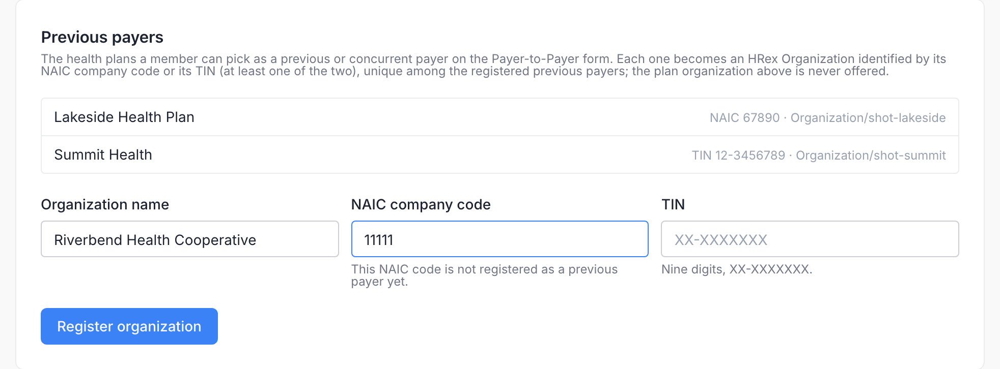

# Consent Settings

The **Settings → Consent** tab of the Admin Portal sets what the member portal's [Data sharing page](member-portal/consent-panel.md) writes into every consent and which health plans members can name for Payer-to-Payer exchange.

Open **Settings → Consent** (`/dashboard/settings/consent`). The tab is shown only on deployments that enable the Consent Panel.

## Capture mode

The first card shows the deployment's capture mode. It is part of the deployment, not a setting on this page:

| Mode | Members | Administrators |
|---|---|---|
| **read-write** | Record and change both choices on the Data sharing page. Where representatives are offered, a representative's choice that shares more waits for [review](consent-reviews.md). | This tab, and the **Data sharing** card on Member Details, with its reviews where representatives are offered. |
| **read-only** | See the choices on file; the controls are disabled and the page points to Member Services. | This tab, and the **Data sharing** card on Member Details. |
| off | No Data sharing page. | No Consent tab, no Data sharing card. |

Changing the mode means changing the deployment: an operator adds or removes the member consent access policies shipped with the portal's Aidbox configuration. The portal notices the change within a minute.

The same card says whether an **authorized representative** can act for a member: *can act for a member* or *not offered*. That is also part of the deployment: the portal's `MEMBER_CONSENT_REPRESENTATIVES_ENABLED=true` turns it on, and it is off otherwise. Turn it on only if your staff check the uploaded documents of authority in [Consent Reviews](consent-reviews.md). Review any pending choices before turning it off again: they can no longer be approved or rejected while it is off, and they never take effect.

## Fields

| Field | What to enter |
|---|---|
| **Plan organization (Aidbox Organization id)** | The `Organization` resource that stands for your plan. Type its id or name and pick it from the suggestions; the line below confirms *Resolves to: <name>*, or says *No Organization with this id was found.* Every consent references it as `Consent.organization` and as the disclosing or receiving payer, and every consent document names it as custodian. The Organization must declare the HRex Organization profile without a version (`http://hl7.org/fhir/us/davinci-hrex/StructureDefinition/hrex-organization` in `meta.profile`); otherwise members' saves are refused. |
| **Payer-to-Payer authorization valid until** | The date every new Payer-to-Payer authorization ends. HRex requires an end date on the opt-in: the form shows it to the member before they save, and the record carries it as `provision.period.end`. It cannot be in the past. A change applies to authorizations saved afterwards; ones already on file keep their date. |
| **Offer "non-sensitive information only" on the Payer-to-Payer form** | Whether members may authorize exchange of non-sensitive information only. As the tab notes, until sensitive data is labeled a member who picks it is returned to other payers as consent-constrained and no data moves; the member page warns the member before they save. |

**Save** is enabled after a change and confirms with *Consent settings updated*. The settings are stored on the admin Aidbox and read by the next save on the member page; no restart is needed. Problems are shown as an error toast before anything is sent, for example *The end date must not be in the past.* or *The organization id may contain letters, digits, dashes, dots and underscores only.* An id that matches no Organization is refused by the server with `Organization/<id> not found`.

Members can save choices only while the settings are complete: the plan organization is set and exists, and the end date is set and has not passed. Until an administrator saves them once, the tab warns *Not configured yet: members cannot save choices until the plan organization and the Payer-to-Payer end date are set.* Afterwards the warning names what is wrong, for example *Members cannot save choices: the Payer-to-Payer end date 2026-01-01 has passed.* or *… the plan organization acme-plan is not found.* While the warning shows, the member page shows the choices on file, and an opened form says the change cannot be made online yet.

## Previous payers

The **Previous payers** card holds the health plans a member can pick as a previous or concurrent payer on the Payer-to-Payer form. Members never type a plan's name freely; they pick from this list, and the plan organization above is never offered.

To register a plan, enter its **Organization name** and at least one of its two codes, the **NAIC company code** (five digits) or the **TIN** (nine digits, `XX-XXXXXXX`; the hyphen may be left out), wait for the hint under the code, and click **Register organization**. Health plans have no NPI: it identifies providers. The hints check each code as you type:

| Hint | Meaning |
|---|---|
| *This NAIC code is not registered as a previous payer yet.* (or *This TIN …*) | Ready to register. |
| *Already registered as <name> (Organization/<id>). Nothing can be created with this NAIC code.* | Another registered previous payer carries this code; the button stays disabled. |
| *Not a valid NAIC code: five digits.* / *Not a valid TIN: nine digits, XX-XXXXXXX.* | The code fails the format test. |

Each registration creates an `Organization` that declares the HRex Organization profile, is typed as a payer (`organization-type` `pay`), carries the NAIC code (`urn:oid:2.16.840.1.113883.6.300`) and/or the TIN (`urn:oid:2.16.840.1.113883.4.4`, stored as `XX-XXXXXXX`) as its identifiers, and is tagged as a registered previous payer. Each code is unique among registered previous payers only: an Organization loaded by a data feed for another purpose, or the plan's own Organization, does not block a registration with the same code. Plans registered with an NPI before this release stay in the list and on the member's form. The portal has no edit or delete action for registered payers.

## Audit

Saving the settings writes a **Settings Updated** audit event, and each registration writes **Previous Payer Registered**. Both appear in the Admin Portal's **Audit Logs** with the administrator who made the change.

## Related


[consent-reviews.md](consent-reviews.md)



[consent-panel.md](member-portal/consent-panel.md)



[consent.md](../api-reference/resources/consent.md)

