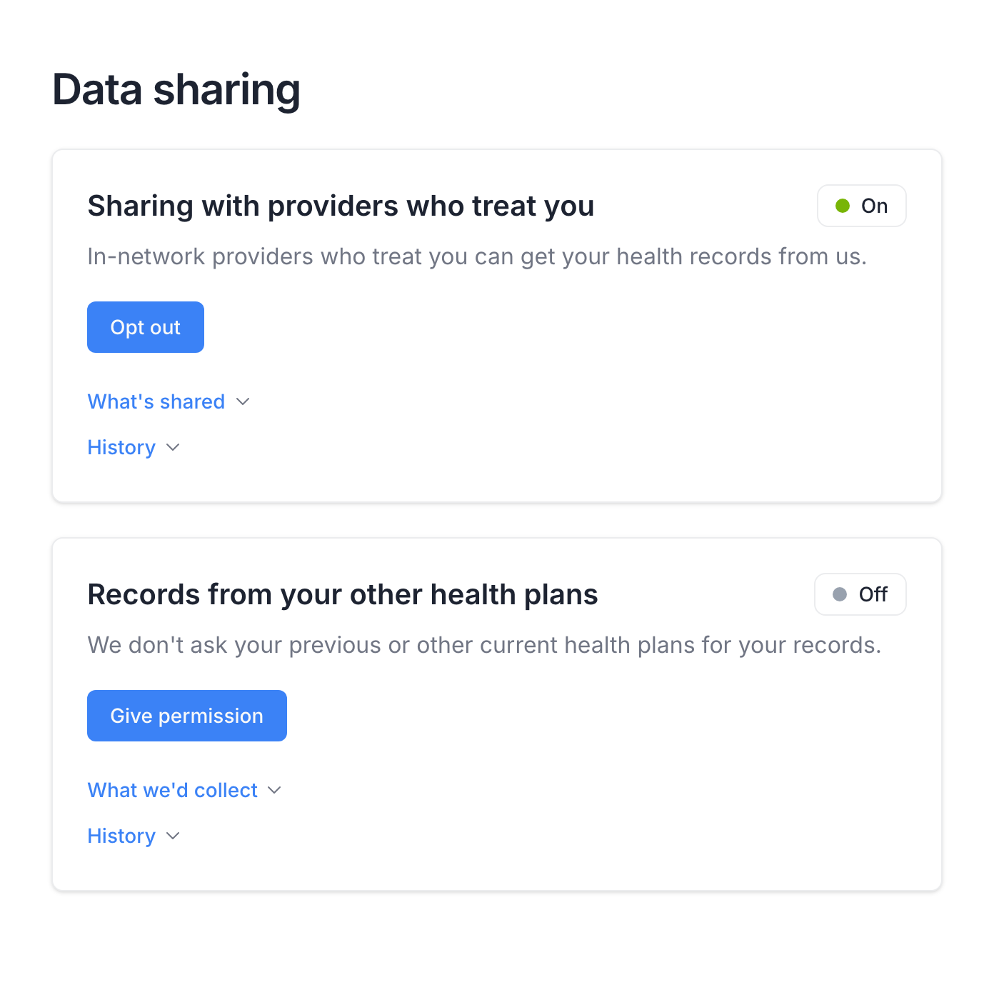
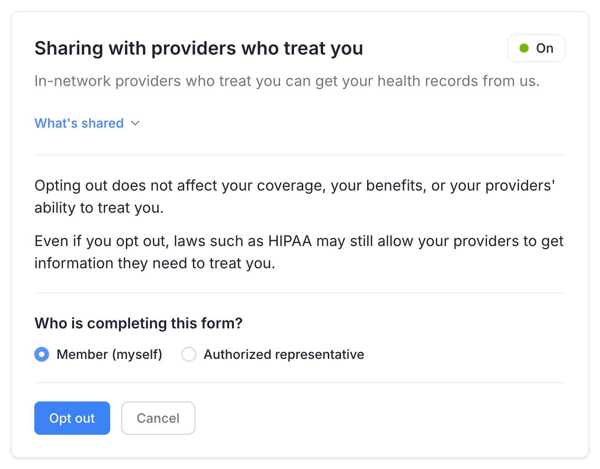
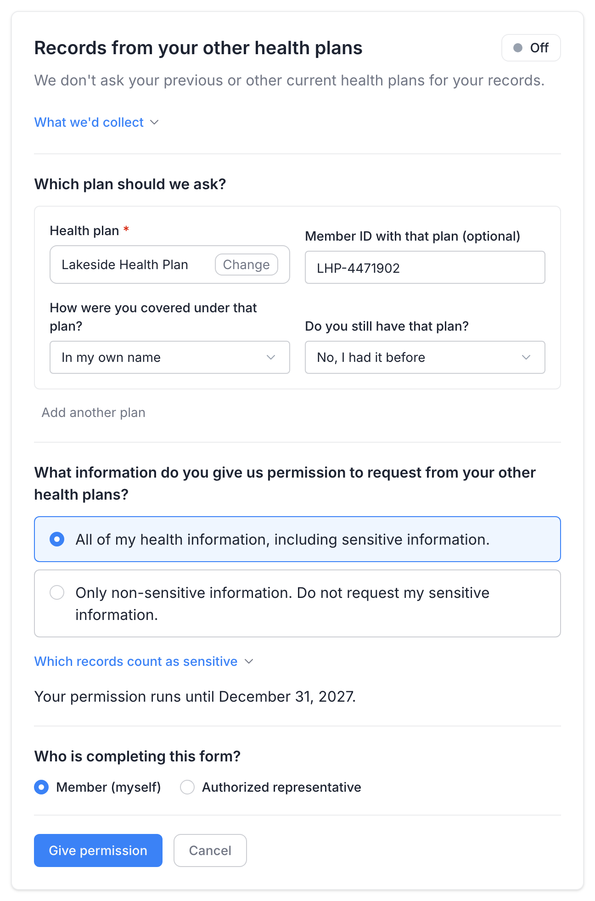
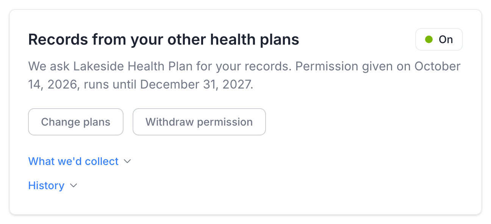
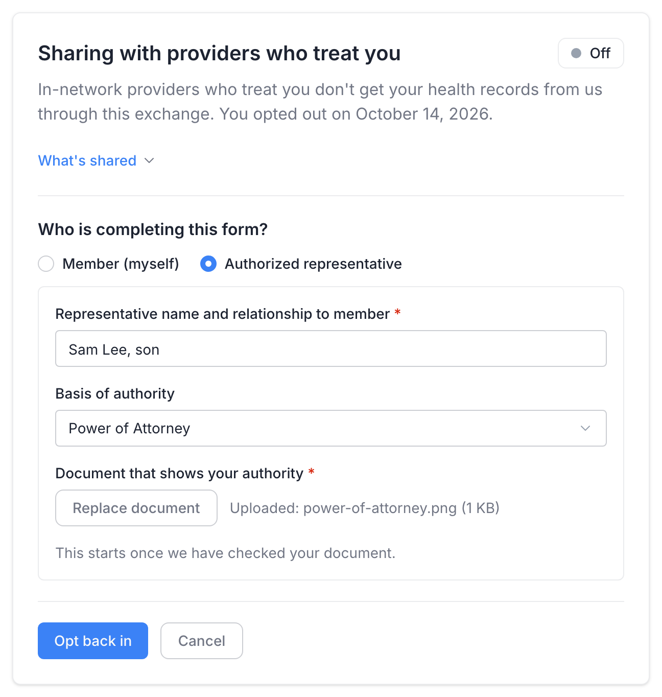
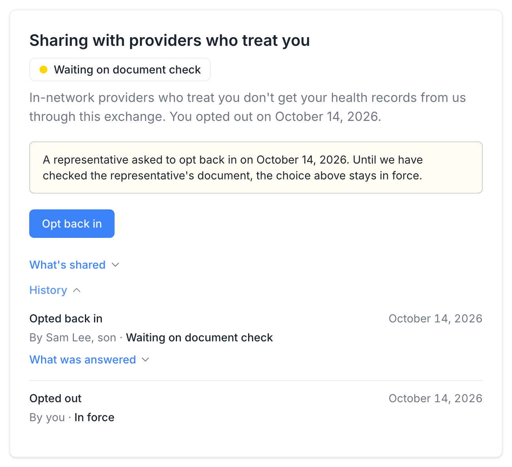
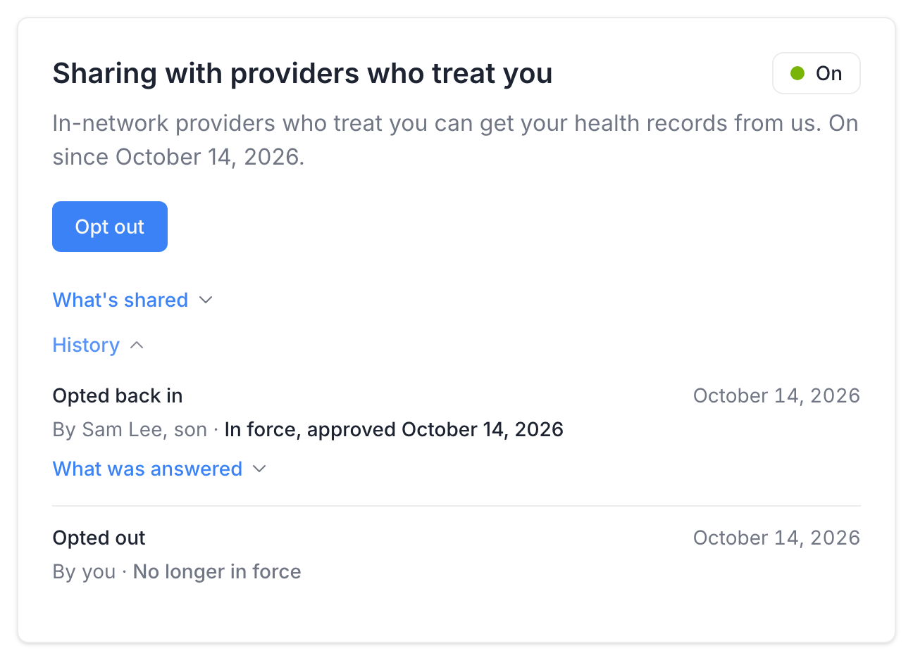
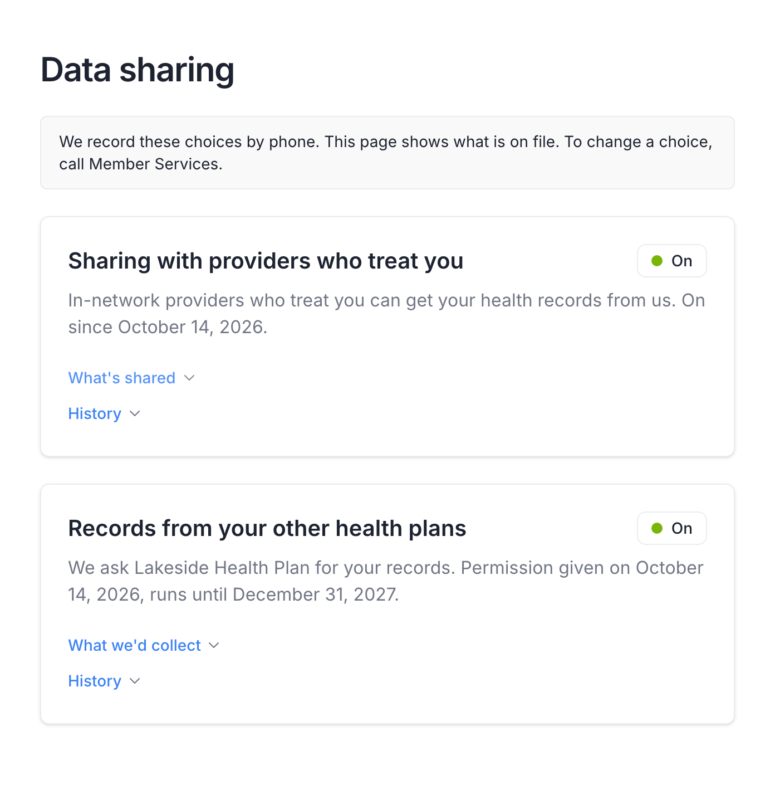

# Consent Panel

Plan members record the two data-sharing choices of [CMS-0057-F](../../compliance/cms-0057.md) themselves, on the **Data sharing** page of the member portal (**Data sharing** in the top navigation, `/consent`):

- **Sharing with providers who treat you**: whether the plan shares the member's record with the in-network providers who treat them through [Provider Access](../../interop-apis/provider-access.md). Sharing is on unless the member opts out.
- **Records from your other health plans**: whether the plan may request the member's records from their previous or concurrent health plans through [Payer-to-Payer](../../interop-apis/payer-to-payer.md). Nothing is requested unless the member gives permission.

This page describes what members see and do there and what each choice records, so that administrators can configure the feature and support members. The plan's side is configured in [Consent Settings](../consent-settings.md), and choices made by an authorized representative are checked in [Consent Reviews](../consent-reviews.md). The page appears only where the deployment turns it on; see [Capture mode](../consent-settings.md#how-the-deployment-is-set-up).

## What members can do

* **See what is on file** for each choice, and since when it applies
* **Opt out of Provider Access**, or opt back in
* **Give permission for Payer-to-Payer exchange**, naming one or more registered previous or concurrent plans, for all information or for non-sensitive information only where the plan offers it; **change the plans**; and **withdraw** the permission
* **Let an authorized representative act for them**, with a document of authority, where the deployment offers it (see [Authorized representatives](#authorized-representatives))
* **Review the history** of each choice and what was answered each time

## The two cards

Each choice has its own card. The card shows the state of the choice (a chip and one sentence), the button that changes it, and two expandable sections: what the exchange covers (**What's shared** or **What we'd collect**: what a treating provider receives or what the plan would collect from the other plan, what is never sent, and the period covered) and the **History**. The button opens the form inside the card, one card at a time. A link ending in `?open=provider-access` or `?open=payer-to-payer` opens that card's form on arrival.

| Card | Chip | Sentence and button |
|---|---|---|
| Sharing with providers who treat you | **On** | *In-network providers who treat you can get your health records from us.*, with the date it was turned on when a choice is on file. This is the default. Button: **Opt out**. |
| Sharing with providers who treat you | **Off** | *In-network providers who treat you don't get your health records from us through this exchange. You opted out on <date>.* Button: **Opt back in**. |
| Records from your other health plans | **Off** | *We don't ask your previous or other current health plans for your records.*, or after a withdrawal *We no longer ask your other plans for your records. Records we received earlier stay in your file.* Button: **Give permission**. |
| Records from your other health plans | **On** | *We ask <plan> for your records. Permission given on <date>, runs until <date>.* With the non-sensitive option: *You chose to leave out sensitive records. <plan> can't separate them yet, so no records come across.* Buttons: **Change plans** and **Withdraw permission**. |
| Either | **Waiting on document check** | A representative recorded a choice that shares more of the record, and it waits for review. A note says what was asked and that the choice above stays in force until the document is checked. |

## Provider Access opt-out



On the **Sharing with providers who treat you** card the member clicks **Opt out**.


The form opens in the card. It shows the two notes from the plan's form (opting out does not affect coverage, benefits or treatment; laws such as HIPAA may still let providers get what they need to treat the member) and, where representatives are offered, asks **Who is completing this form?** with **Member (myself)** and **Authorized representative**.


The member clicks **Opt out**. There is no confirmation checkbox: the button is the confirmation, and the member's session identifies who submitted it.



A member's own choice takes effect when it is saved, and the record it replaces stops being in force. From then on, Provider Access responses leave this member's data out. To turn sharing back on, the member clicks **Opt back in**: the form asks only who is completing it.

## Payer-to-Payer permission



On the **Records from your other health plans** card the member clicks **Give permission**.


Under **Which plan should we ask?** the member types the plan's name in **Health plan** and picks it from the list. Only plans registered in [Consent Settings](../consent-settings.md#other-health-plans-members-can-pick) appear. The member adds their **Member ID with that plan** (optional), answers **How were you covered under that plan?** (in their own name, through a spouse or partner, through a parent, another way) and **Do you still have that plan?** (no, they had it before; yes, they have it now too). **Add another plan** names more; **Remove** drops one.


Where the plan offers the non-sensitive option, the form then asks **What information do you give us permission to request from your other health plans?**: **All of my health information, including sensitive information.** or **Only non-sensitive information. Do not request my sensitive information.** **Which records count as sensitive** lists the kinds of care with extra protection. Without that option the form states that all information will be requested. The form shows the date the permission runs until.


The member answers **Who is completing this form?** where it is asked, and clicks **Give permission**.



The permission runs until the date set in [Consent Settings](../consent-settings.md). Once it is saved, the card names the plans:

Picking **Only non-sensitive information** shows a warning before saving: *Choosing this sends nothing today.* Other plans cannot yet separate specially protected records from the rest, so they hold back the member's whole history. The card says so afterwards as well.

**Change plans** opens the form again, starting from the plans of the permission in force, so the member edits the list rather than retyping it. **Withdraw permission** opens a form with only the note that records already received stay in the member's file and the question of who is completing it; the plan stops asking from that day.

### Missing or failed answers

If the member clicks the button with something missing, the form lists what is needed, for example *Pick the health plan from the list.* or *Upload the document that shows your authority.*, and nothing is saved.

If a save fails, nothing is saved, the form stays open, and the member sees *Sorry, we can't save it now. Please try again later or contact Member Services.* When the session has expired in the meantime, the form says so and offers **Sign in again**.

## Authorized representatives

Representatives are offered only where the portal runs with `MEMBER_CONSENT_REPRESENTATIVES_ENABLED=true`, for plans whose staff check documents of authority. Elsewhere the form does not ask who completes it, the member always completes it, and there is nothing to review.

Where it is offered, picking **Authorized representative** adds:

| Field | What the representative enters |
|---|---|
| **Representative name and relationship to member** | For example *Sam Lee, son*. |
| **Basis of authority** | **Power of Attorney**, **Legal guardian**, or **Other** with a description. |
| **Document that shows your authority** | The power of attorney, guardianship papers or equivalent: a PDF, JPEG or PNG file of up to 10 MB, uploaded with **Choose file**. |

When the choice applies depends on its direction, and the form says which under the representative's details before they save:

| Choice | When it applies |
|---|---|
| Shares less: opting out of Provider Access, withdrawing a Payer-to-Payer permission | At once (*This takes effect right away.*). The plan checks the document afterwards. |
| Shares more: opting back in to Provider Access, giving Payer-to-Payer permission | After an administrator has checked the document and approved the choice in [Consent Reviews](../consent-reviews.md) (*This starts once we have checked your document.*). Until then the card shows **Waiting on document check** and the earlier choice stays in force. |

## History

**History**, on each card, lists every choice recorded for that switch, newest first: what was done (*Opted out*, *Opted back in*, *Gave permission*, *Gave permission, non-sensitive records only*, *Withdrew permission*), the date, who submitted it (*By you*, or the representative's name) and its status. **What was answered** appears under a row that recorded more than the choice itself, such as the plans named or the representative's details, and shows the answers as they were submitted.

| Status | Meaning |
|---|---|
| **In force** | The choice that currently applies. |
| **In force, approved <date>** | A representative's choice that an administrator approved on that date. |
| **No longer in force** | A later choice replaced it. |
| **Waiting on document check** | A representative's choice waiting for review. |
| **Not approved** | An administrator rejected the representative's choice. The internal note is never shown to the member. |
| **Withdrawn** | A withdrawal of a Payer-to-Payer permission. |
| **Ended <date>**, **Takes effect <date>** | A choice whose dates have passed or not started yet. |

After an administrator approves the representative's request above, the card reads:

## Read-only and unconfigured deployments

Where the plan records these choices through Member Services, the deployment runs in read-only [capture mode](../consent-settings.md#how-the-deployment-is-set-up): the page shows what is on file without the buttons, under the note *We record these choices by phone. This page shows what is on file. To change a choice, call Member Services.*

Until the plan organization and a Payer-to-Payer end date that has not passed are set in [Consent Settings](../consent-settings.md), the buttons are there but an opened form shows only *You can't make this change online yet. Call Member Services to record your choice.* and **Cancel**.

## What a saved choice records

Each save writes one set of FHIR records under the member's own session, all together or not at all:

- the answered form, a `QuestionnaireResponse`, in which a coded answer carries the option text the member saw, so the record reads as it was even after the form's wording changes;
- a consent document that indexes it, a `DocumentReference`;
- the `Consent` itself;
- a `Provenance` record of who submitted it and how, which also names the earlier `Consent` records the save retired;
- for a representative, also a `RelatedPerson` and a second `DocumentReference` for the uploaded document.

The `Consent` is what the APIs read: the Provider Access opt-out is checked by [`$provider-member-match`](../../api-reference/operations/provider-member-match.md) and by every Provider Access export, and the Payer-to-Payer permission names the plans the plan may ask. The records, their profiles and how to query them are in the [Consent](../../api-reference/resources/consent.md) reference.

## Related


[consent-settings.md](../consent-settings.md)



[consent-reviews.md](../consent-reviews.md)



[consent.md](../../api-reference/resources/consent.md)

