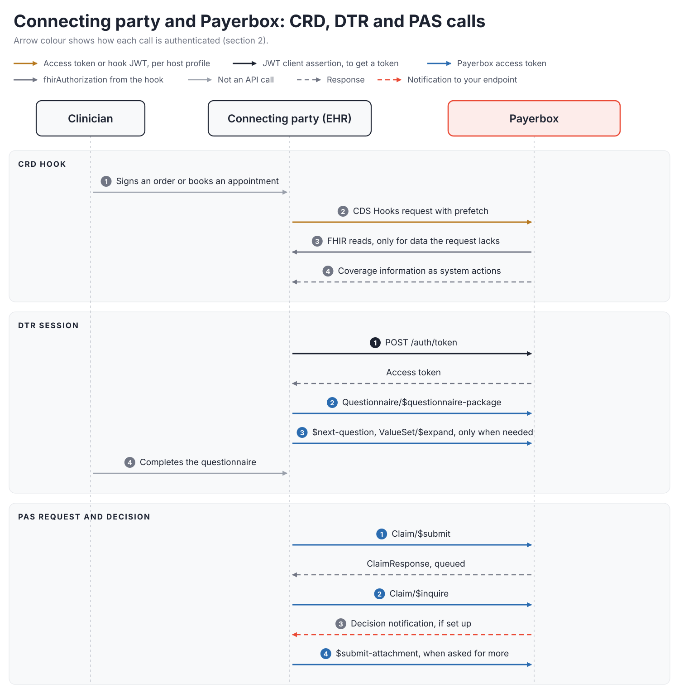

# Prior Auth Integration Guide

**For engineers who connect an EHR or a prior authorization system to a payer's Payerbox: CRD, DTR and PAS**



Payerbox answers a payer's prior authorization APIs under the [CMS Interoperability and Prior Authorization Final Rule (CMS-0057-F)](../compliance/cms-0057.md). This guide shows every call a connecting party makes, each with a request and the response Payerbox returns, and how onboarding and testing run. Values that belong to one installation, such as base URLs, are in that installation's host profile (Appendix B). The field-level reference is the [Payerbox API reference](../api-reference/operations/README.md).

Terms used throughout:

- **Payerbox host**: the organization that runs Payerbox, a health plan or an organization the plan delegates utilization management (UM) to. It owns the coverage rules, questionnaires and UM decisions, issues credentials and runs the environments.
- **Connecting party**: the system that calls Payerbox: a provider's electronic health record system (EHR), a prior authorization vendor acting for providers, or a health plan's system that forwards requests to its delegate.
- **[CRD](crd.md)** (Coverage Requirements Discovery): while a clinician orders, the EHR asks Payerbox whether the service is covered and needs prior authorization.
- **[DTR](dtr/README.md)** (Documentation Templates and Rules): the EHR fetches the questionnaire for the documentation the authorization needs, and the clinician completes it.
- **[PAS](pas.md)** (Prior Authorization Support): the EHR submits the prior authorization request and gets the decision.
- **`<base>`**: the base URL of one Payerbox environment, from the host profile.

**What is supported.** Anything that neither this guide nor the Payerbox API reference describes is not supported, unless the Payerbox host confirms it in writing during onboarding.

## 1. Standards

| Standard | Version |
| :- | :- |
| [HL7 FHIR](https://hl7.org/fhir/R4/) | R4 (4.0.1) |
| [US Core](https://hl7.org/fhir/us/core/STU6.1/) | 6.1.0 |
| [Da Vinci CRD](https://hl7.org/fhir/us/davinci-crd/STU2.1/) | STU 2.1.0 |
| [Da Vinci DTR](https://hl7.org/fhir/us/davinci-dtr/STU2.1/) | STU 2.1.0 |
| [Da Vinci PAS](https://hl7.org/fhir/us/davinci-pas/STU2.1/) | STU 2.1.0 |
| [CDS Hooks](https://cds-hooks.hl7.org/2.0/) | 2.0 |
| [SMART Backend Services](https://hl7.org/fhir/smart-app-launch/STU2.2/backend-services.html) | 2.2.0 |

The full list, including CDex and HRex, is on the [Implementation guides](../api-reference/implementation-guides.md) page.

CRD hook requests are `application/json`. DTR and PAS requests are `application/fhir+json`.

## 2. Connect and authenticate

### Endpoints

| Endpoint | Address |
| :- | :- |
| CRD discovery | `GET <base>/cds-services` |
| CRD hooks | `POST <base>/cds-services/<service id>` |
| FHIR API (DTR and PAS) | `<base>/fhir` |
| Token endpoint | `POST <base>/auth/token` |

| CRD hook | Service id | When the EHR calls it |
| :- | :- | :- |
| `order-sign` | `order-sign-crd` | The clinician signs an order |
| `order-select` | `order-select-crd` | The clinician selects an order, before signing |
| `order-dispatch` | `order-dispatch-crd` | The order is sent to a performer, for example a supplier of durable medical equipment |
| `appointment-book` | `appointment-book-crd` | An appointment is booked |

The host can limit which hooks are enabled. Discovery lists the enabled ones with the prefetch each asks for (section 3); a call to a hook that is not enabled returns 404. The host profile says whether discovery needs a token.

### Register your keys

1. Publish your public keys as a JSON Web Key Set at a URL Payerbox can reach (JWK Set URL, JKU), or send the key set itself. A URL is preferred: Payerbox refreshes the keys from it. Each key carries `kty`, `kid` and `"use": "sig"`; RSA keys also `n` and `e`, EC keys `crv`, `x` and `y`. A token request signed with a key that lacks `"use": "sig"` is refused.
2. Send the JKU to the host. The host registers your system as a client and sends back its `client_id`.
3. If your JWTs carry a `jku` header, it must equal the registered JKU character for character.
4. To rotate a key, publish the new key, keep the old one until the switch is done, then remove it.

No client secret is used.

### Get an access token

Sign a short JWT with your private key and exchange it at the token endpoint. Use RS384 or ES384; RS512 and ES512 are refused.

JWT header and claims:

```json
{
  "header": { "alg": "RS384", "kid": "guide-key-1", "typ": "JWT" },
  "claims": {
    "iss": "guide-backend",
    "sub": "guide-backend",
    "aud": "<base>/auth/token",
    "exp": 1795133433,
    "jti": "75b70ecbe3824d9a967b979fa57536d4"
  }
}
```

- `kid` in the header: a key in your key set.
- `iss` and `sub`: your `client_id`.
- `aud`: the token endpoint.
- `exp`: no more than 5 minutes ahead.
- `jti`: unique for every request. A replayed JWT is refused.

The `scope` parameter is required: without it Payerbox returns 400 with `{"message": "no scope provided"}`. The host gives the value to send (worksheet A6).




```http
POST <base>/auth/token
Content-Type: application/x-www-form-urlencoded

grant_type=client_credentials
&scope=<value from the host>
&client_assertion_type=urn%3Aietf%3Aparams%3Aoauth%3Aclient-assertion-type%3Ajwt-bearer
&client_assertion=<signed JWT>
```




```json
{
  "token_type": "Bearer",
  "scope": "<value from the host>",
  "expires_in": 300,
  "access_token": "<access token>"
}
```




Every DTR and PAS call carries the token as `Authorization: Bearer <access token>`. When it expires, after `expires_in` seconds, request a new one the same way.

### Authenticate the CRD hook call

The host profile says which of the two applies:

- **Payerbox access token.** The hook request carries `Authorization: Bearer <access token>`, obtained as above.
- **JWT signed by your EHR for each hook request,** as CDS Hooks describes. Claims: `iss` = your FHIR server's base URL, `aud` = the CDS service URL being called, `sub` = your `client_id`, plus `exp`, `iat` and `jti`. Payerbox verifies it against the JKU you register for hooks.

`fhirAuthorization` in the hook request is optional. Payerbox uses it only to read data that the request and its prefetch lack.

### What else protects a call

- **Per-client access.** The host's access policies allow each connecting party only the operations it calls. Any other call is refused with 403. The `scope` value in the token request does not widen this.
- **Required headers.** The host can require headers on every CRD hook call. A call without them is refused with 400 before any coverage rule runs.
- **Network.** TLS, an allowlist of source IP addresses and client certificates are set up by the host on its network; the host profile lists which apply.

## 3. CRD

Send the hook request with the hook context and prefetch. Include the patient's coverage, in the order's insurance or in `prefetch.coverage`: without coverage no coverage answer comes back.

Prefetch Payerbox asks for in discovery:

| Key | Template | Hooks |
| :- | :- | :- |
| `patient` | `Patient/{{context.patientId}}` | `order-sign`, `order-select`, `order-dispatch`, `appointment-book` |
| `encounter` | `Encounter/{{context.encounterId}}` | `order-sign`, `order-select`, `appointment-book` |
| `coverage` | `Coverage?patient={{context.patientId}}&status=active` | `order-sign`, `order-select`, `order-dispatch`, `appointment-book` |
| `performer` | `{{context.performer}}` | `order-dispatch` |




```http
POST <base>/cds-services/order-sign-crd

{
  "hook": "order-sign",
  "hookInstance": "e29dd283-4adc-4c19-9c75-a681996b6871",
  "context": {
    "userId": "Practitioner/practitioner-guide-1",
    "patientId": "patient-guide-1",
    "draftOrders": {
      "resourceType": "Bundle",
      "type": "collection",
      "entry": [
        {
          "resource": {
            "resourceType": "ServiceRequest",
            "id": "sr-guide-1",
            "status": "draft",
            "intent": "order",
            "authoredOn": "2026-11-19",
            "occurrenceDateTime": "2026-11-19",
            "code": {
              "coding": [
                {
                  "system": "http://www.ama-assn.org/go/cpt",
                  "code": "95810",
                  "display": "Polysomnography; age 6 years or older, sleep staging with 4 or more additional parameters of sleep, attended by a technologist"
                }
              ]
            },
            "subject": { "reference": "Patient/patient-guide-1" },
            "insurance": [{ "reference": "Coverage/coverage-guide-1" }]
          }
        }
      ]
    }
  },
  "prefetch": {
    "patient": {
      "resourceType": "Patient",
      "id": "patient-guide-1",
      "identifier": [{ "system": "http://example.org/MIN", "value": "GUIDE00001" }],
      "name": [{ "family": "Sample", "given": ["Alex"] }],
      "gender": "female",
      "birthDate": "1975-04-12"
    },
    "coverage": {
      "resourceType": "Coverage",
      "id": "coverage-guide-1",
      "status": "active",
      "subscriberId": "GUIDE00001",
      "beneficiary": { "reference": "Patient/patient-guide-1" },
      "payor": [{ "reference": "Organization/organization-sleep", "display": "Demo Health Plan" }],
      "period": { "start": "2026-01-01" },
      "class": [
        {
          "type": {
            "coding": [
              { "system": "http://terminology.hl7.org/CodeSystem/coverage-class", "code": "plan" }
            ]
          },
          "value": "sleep-commercial",
          "name": "Demo Health Plan Commercial"
        }
      ]
    }
  }
}
```




```json
{
  "cards": [
    {
      "source": { "url": "https://example.org/health-plan", "label": "Demo Health Plan" },
      "summary": "Prior authorization required",
      "indicator": "warning",
      "links": [
        {
          "url": "https://example.org/policy/sleep-study-policy",
          "type": "absolute",
          "label": "View Policy Details"
        }
      ],
      "detail": "Complete the documentation for the requested sleep study."
    }
  ],
  "systemActions": [
    {
      "description": "Annotate the draft ServiceRequest with CRD coverage information.",
      "type": "update",
      "resource": {
        "resourceType": "ServiceRequest",
        "id": "sr-guide-1",
        "insurance": [{ "reference": "Coverage/coverage-guide-1" }],
        "authoredOn": "2026-11-19",
        "extension": [
          {
            "url": "http://hl7.org/fhir/us/davinci-crd/StructureDefinition/ext-coverage-information",
            "extension": [
              { "url": "coverage", "valueReference": { "reference": "Coverage/coverage-guide-1" } },
              { "url": "covered", "valueCode": "covered" },
              { "url": "pa-needed", "valueCode": "auth-needed" },
              { "url": "doc-needed", "valueCode": "clinical" },
              {
                "url": "questionnaire",
                "valueCanonical": "http://healthsamurai.io/fhir/Questionnaire/sleep-study-95810-commercial|0.2.1"
              },
              { "url": "date", "valueDate": "2026-11-20" },
              {
                "url": "coverage-assertion-id",
                "valueString": "adc64c8e-612d-4deb-9581-26cb96fc77e7"
              }
            ]
          }
        ],
        "status": "draft",
        "code": {
          "coding": [
            {
              "system": "http://www.ama-assn.org/go/cpt",
              "code": "95810",
              "display": "Polysomnography; age 6 years or older, sleep staging with 4 or more additional parameters of sleep, attended by a technologist"
            }
          ]
        },
        "intent": "order",
        "occurrenceDateTime": "2026-11-19",
        "subject": { "reference": "Patient/patient-guide-1" }
      }
    }
  ]
}
```




What the response means:

- Each order the coverage rules evaluated comes back as a `systemActions` entry of type `update` that carries the `ext-coverage-information` extension. The EHR stores it on the order without asking the clinician.
- An order comes back without a system action when no coverage was sent for it, or, on `order-select`, when the coverage rules cannot evaluate it: `order-select` then returns the card only.
- `pa-needed` = `auth-needed`: submit a PAS request (section 5).
- `doc-needed` and `questionnaire`: open DTR with that questionnaire URL (section 4).
- `covered` = `conditional`: no firm answer; `info-needed` and `reason` say why, for example that the host's rules could not evaluate the order.
- Cards are information for the clinician. The coverage answer the EHR stores is the system action.

A service that needs no prior authorization, the extension only:

```json
{
  "url": "http://hl7.org/fhir/us/davinci-crd/StructureDefinition/ext-coverage-information",
  "extension": [
    { "url": "coverage", "valueReference": { "reference": "Coverage/coverage-guide-1" } },
    { "url": "covered", "valueCode": "covered" },
    { "url": "pa-needed", "valueCode": "no-auth" },
    { "url": "date", "valueDate": "2026-11-20" },
    { "url": "coverage-assertion-id", "valueString": "149a5b00-289a-45e7-8d95-def5d5d38c33" }
  ]
}
```

When the host's coverage rules report that they cannot evaluate the order:

```json
{
  "url": "http://hl7.org/fhir/us/davinci-crd/StructureDefinition/ext-coverage-information",
  "extension": [
    { "url": "coverage", "valueReference": { "reference": "Coverage/coverage-guide-2" } },
    { "url": "covered", "valueCode": "conditional" },
    { "url": "info-needed", "valueCode": "OTH" },
    {
      "url": "reason",
      "valueCodeableConcept": {
        "text": "Coverage requirements could not be evaluated for this order."
      }
    },
    { "url": "date", "valueDate": "2026-11-20" },
    { "url": "coverage-assertion-id", "valueString": "305e66b8-5df3-4565-b08b-f6b66ee43f38" }
  ]
}
```

## 4. DTR

Either the DTR SMART app launched from the EHR shows the questionnaire, or your own DTR client calls the package operation. The host profile says which the host offers.




```http
POST <base>/fhir/Questionnaire/$questionnaire-package
Content-Type: application/fhir+json

{
  "resourceType": "Parameters",
  "parameter": [
    {
      "name": "questionnaire",
      "valueCanonical": "http://healthsamurai.io/fhir/Questionnaire/sleep-study-95810-commercial|0.2.1"
    },
    {
      "name": "coverage",
      "resource": {
        "resourceType": "Coverage",
        "id": "coverage-guide-1",
        "status": "active",
        "subscriberId": "GUIDE00001",
        "beneficiary": { "reference": "Patient/patient-guide-1" },
        "payor": [{ "reference": "Organization/organization-sleep", "display": "Demo Health Plan" }],
        "period": { "start": "2026-01-01" },
        "class": [
          {
            "type": {
              "coding": [
                { "system": "http://terminology.hl7.org/CodeSystem/coverage-class", "code": "plan" }
              ]
            },
            "value": "sleep-commercial",
            "name": "Demo Health Plan Commercial"
          }
        ]
      }
    },
    {
      "name": "order",
      "resource": {
        "resourceType": "ServiceRequest",
        "id": "sr-guide-1",
        "status": "draft",
        "intent": "order",
        "authoredOn": "2026-11-19",
        "occurrenceDateTime": "2026-11-19",
        "code": {
          "coding": [
            {
              "system": "http://www.ama-assn.org/go/cpt",
              "code": "95810",
              "display": "Polysomnography; age 6 years or older, sleep staging with 4 or more additional parameters of sleep, attended by a technologist"
            }
          ]
        },
        "subject": { "reference": "Patient/patient-guide-1" },
        "insurance": [{ "reference": "Coverage/coverage-guide-1" }]
      }
    }
  ]
}
```




Abbreviated to the first group of questions: the questionnaire, then any value set of 40 codes or fewer it references, then a draft response prefilled from the coverage and the order. Here the first answer is prefilled from the order's CPT code.

```json
{
  "resourceType": "Parameters",
  "parameter": [
    {
      "name": "packagebundle",
      "resource": {
        "resourceType": "Bundle",
        "type": "collection",
        "entry": [
          {
            "resource": {
              "resourceType": "Questionnaire",
              "id": "sleep-study-95810-commercial",
              "url": "http://healthsamurai.io/fhir/Questionnaire/sleep-study-95810-commercial",
              "version": "0.2.1",
              "status": "draft",
              "title": "Demo Health Plan Sleep Study Prior Authorization, 95810 Commercial",
              "item": [
                {
                  "item": [
                    {
                      "text": "Requested sleep study service",
                      "type": "choice",
                      "linkId": "requested-service",
                      "extension": [
                        {
                          "url": "http://hl7.org/fhir/uv/sdc/StructureDefinition/sdc-questionnaire-initialExpression",
                          "valueExpression": {
                            "language": "text/fhirpath",
                            "expression": "%order.code.coding.where(system='http://www.ama-assn.org/go/cpt').first()"
                          }
                        }
                      ],
                      "answerOption": [
                        {
                          "valueCoding": {
                            "code": "95810",
                            "system": "http://www.ama-assn.org/go/cpt",
                            "display": "95810 - Polysomnography, age 6 years or older, sleep staging with 4 or more additional parameters, attended by a technologist"
                          }
                        }
                      ]
                    },
                    {
                      "text": "What is the primary diagnosis/reason for the request?",
                      "type": "string",
                      "linkId": "primary-diagnosis",
                      "extension": [
                        {
                          "url": "http://hl7.org/fhir/uv/sdc/StructureDefinition/sdc-questionnaire-initialExpression",
                          "valueExpression": {
                            "language": "text/fhirpath",
                            "expression": "iif(%order.reasonCode.exists(), %order.reasonCode.first().coding.first().code + ' - ' + %order.reasonCode.first().coding.first().display, {})"
                          }
                        }
                      ]
                    }
                  ],
                  "text": "Request and diagnosis",
                  "type": "group",
                  "linkId": "common"
                }
              ]
            }
          },
          {
            "resource": {
              "resourceType": "QuestionnaireResponse",
              "questionnaire": "http://healthsamurai.io/fhir/Questionnaire/sleep-study-95810-commercial|0.2.1",
              "status": "in-progress",
              "subject": { "reference": "Patient/patient-guide-1" },
              "extension": [
                {
                  "url": "http://hl7.org/fhir/us/davinci-dtr/StructureDefinition/qr-context",
                  "valueReference": { "reference": "Coverage/coverage-guide-1" }
                },
                {
                  "url": "http://hl7.org/fhir/us/davinci-dtr/StructureDefinition/qr-context",
                  "valueReference": { "reference": "ServiceRequest/sr-guide-1" }
                },
                {
                  "url": "http://hl7.org/fhir/us/davinci-dtr/StructureDefinition/intendedUse",
                  "valueCodeableConcept": {
                    "coding": [
                      { "system": "http://hl7.org/fhir/us/davinci-crd/CodeSystem/temp", "code": "withpa" }
                    ]
                  }
                }
              ],
              "item": [
                {
                  "linkId": "common",
                  "text": "Request and diagnosis",
                  "item": [
                    {
                      "linkId": "requested-service",
                      "text": "Requested sleep study service",
                      "answer": [
                        {
                          "valueCoding": {
                            "system": "http://www.ama-assn.org/go/cpt",
                            "code": "95810",
                            "display": "Polysomnography; age 6 years or older, sleep staging with 4 or more additional parameters of sleep, attended by a technologist"
                          }
                        }
                      ]
                    },
                    {
                      "linkId": "primary-diagnosis",
                      "text": "What is the primary diagnosis/reason for the request?"
                    }
                  ]
                }
              ]
            }
          }
        ]
      }
    }
  ]
}
```




- The output parameter is `PackageBundle`, as defined in DTR STU 2.1.0. Match the name without regard to case.
- One call returns one questionnaire, requested by its URL. CQL libraries are not included.
- A value set with more than 40 codes is left out of the package, with an information issue in `outcome`. Fetch it with `GET <base>/fhir/ValueSet/$expand?url=<value set URL>`.
- Adaptive questionnaires, if the host uses them, continue with `POST <base>/fhir/Questionnaire/$next-question`.
- Not supported: the `context` and `changedsince` parameters, and `$log-questionnaire-errors`.
- The completed QuestionnaireResponse goes into the PAS request bundle (section 5).

## 5. PAS

### Submit a request

`POST <base>/fhir/Claim/$submit` with a PAS request bundle: one Claim and every resource it references. Several requests mean several calls.




```http
POST <base>/fhir/Claim/$submit
Content-Type: application/fhir+json

{
  "resourceType": "Bundle",
  "type": "collection",
  "timestamp": "2026-11-20T00:12:28Z",
  "meta": {
    "profile": ["http://hl7.org/fhir/us/davinci-pas/StructureDefinition/profile-pas-request-bundle"]
  },
  "identifier": {
    "system": "http://example.org/SUBMITTER_TRANSACTION_IDENTIFIER",
    "value": "SUB-GUIDE-URN-1"
  },
  "entry": [
    {
      "fullUrl": "urn:uuid:86fd4cdf-464a-5d4e-8ffb-65fc0943abeb",
      "resource": {
        "resourceType": "Claim",
        "id": "claim-guide-urn-1",
        "meta": {
          "profile": ["http://hl7.org/fhir/us/davinci-pas/StructureDefinition/profile-claim"]
        },
        "identifier": [
          { "system": "http://example.org/PATIENT_EVENT_TRACE_NUMBER", "value": "TRN-GUIDE-URN-1" }
        ],
        "status": "active",
        "type": {
          "coding": [
            { "system": "http://terminology.hl7.org/CodeSystem/claim-type", "code": "professional" }
          ]
        },
        "use": "preauthorization",
        "patient": { "reference": "urn:uuid:2fd56e17-e628-5820-8abc-7575412b4fcd" },
        "created": "2026-11-20T00:12:28Z",
        "insurer": { "reference": "urn:uuid:082166fa-1647-58ff-bff4-b032a3c56d92" },
        "provider": { "reference": "urn:uuid:d47983c3-629a-5dd5-bf32-ec6b4fcda7d4" },
        "priority": {
          "coding": [
            { "system": "http://terminology.hl7.org/CodeSystem/processpriority", "code": "normal" }
          ]
        },
        "careTeam": [
          {
            "extension": [
              {
                "url": "http://hl7.org/fhir/us/davinci-pas/StructureDefinition/extension-careTeamClaimScope",
                "valueBoolean": true
              }
            ],
            "sequence": 1,
            "provider": { "reference": "urn:uuid:44f3073a-1fe7-5e0d-88c9-475074519498" }
          }
        ],
        "supportingInfo": [
          {
            "sequence": 1,
            "category": {
              "coding": [
                {
                  "system": "http://hl7.org/fhir/us/davinci-pas/CodeSystem/PASTempCodes",
                  "code": "additionalInformation"
                }
              ]
            },
            "valueReference": { "reference": "urn:uuid:952be101-2232-577c-9ed3-2348293fd571" }
          }
        ],
        "diagnosis": [
          {
            "sequence": 1,
            "diagnosisCodeableConcept": {
              "coding": [
                {
                  "system": "http://hl7.org/fhir/sid/icd-10-cm",
                  "code": "G47.33",
                  "display": "Obstructive sleep apnea (adult) (pediatric)"
                }
              ]
            }
          }
        ],
        "insurance": [
          {
            "sequence": 1,
            "focal": true,
            "coverage": { "reference": "urn:uuid:c56a5628-d8e1-51e2-8ccb-d982bf6c784e" }
          }
        ],
        "item": [
          {
            "sequence": 1,
            "extension": [
              {
                "url": "http://hl7.org/fhir/us/davinci-pas/StructureDefinition/extension-serviceItemRequestType",
                "valueCodeableConcept": {
                  "coding": [
                    {
                      "system": "https://codesystem.x12.org/005010/1525",
                      "code": "HS",
                      "display": "Health Services Review"
                    }
                  ]
                }
              },
              {
                "url": "http://hl7.org/fhir/us/davinci-pas/StructureDefinition/extension-certificationType",
                "valueCodeableConcept": {
                  "coding": [
                    { "system": "https://codesystem.x12.org/005010/1322", "code": "I", "display": "Initial" }
                  ]
                }
              }
            ],
            "careTeamSequence": [1],
            "diagnosisSequence": [1],
            "category": {
              "coding": [
                { "system": "https://codesystem.x12.org/005010/1365", "code": "1", "display": "Medical Care" }
              ]
            },
            "productOrService": {
              "coding": [
                {
                  "system": "http://www.ama-assn.org/go/cpt",
                  "code": "95810",
                  "display": "Polysomnography; age 6 years or older, sleep staging with 4 or more additional parameters of sleep, attended by a technologist"
                }
              ]
            },
            "servicedDate": "2026-12-01",
            "locationCodeableConcept": {
              "coding": [
                {
                  "system": "https://www.cms.gov/Medicare/Coding/place-of-service-codes/Place_of_Service_Code_Set",
                  "code": "11"
                }
              ]
            },
            "quantity": { "value": 1 }
          }
        ]
      }
    },
    {
      "fullUrl": "urn:uuid:2fd56e17-e628-5820-8abc-7575412b4fcd",
      "resource": {
        "resourceType": "Patient",
        "id": "patient-guide-1",
        "identifier": [
          {
            "type": {
              "coding": [{ "system": "http://terminology.hl7.org/CodeSystem/v2-0203", "code": "MB" }]
            },
            "system": "http://example.org/member-id",
            "value": "GUIDE00001"
          }
        ],
        "name": [{ "family": "Sample", "given": ["Alex"] }],
        "gender": "female",
        "birthDate": "1975-04-12",
        "meta": {
          "profile": ["http://hl7.org/fhir/us/davinci-pas/StructureDefinition/profile-beneficiary"]
        },
        "address": [{ "country": "US" }]
      }
    },
    {
      "fullUrl": "urn:uuid:082166fa-1647-58ff-bff4-b032a3c56d92",
      "resource": {
        "resourceType": "Organization",
        "id": "insurer-guide-1",
        "meta": {
          "profile": ["http://hl7.org/fhir/us/davinci-pas/StructureDefinition/profile-insurer"]
        },
        "identifier": [{ "system": "http://hl7.org/fhir/sid/us-npi", "value": "1497758544" }],
        "active": true,
        "type": [{ "coding": [{ "system": "https://codesystem.x12.org/005010/98", "code": "PR" }] }],
        "name": "Demo Health Plan"
      }
    },
    {
      "fullUrl": "urn:uuid:d47983c3-629a-5dd5-bf32-ec6b4fcda7d4",
      "resource": {
        "resourceType": "Organization",
        "id": "requestor-guide-1",
        "meta": {
          "profile": ["http://hl7.org/fhir/us/davinci-pas/StructureDefinition/profile-requestor"]
        },
        "identifier": [
          { "system": "http://hl7.org/fhir/sid/us-npi", "value": "1234567893" },
          { "system": "http://terminology.hl7.org/NamingSystem/USEIN", "value": "123456789" }
        ],
        "active": true,
        "type": [{ "coding": [{ "system": "https://codesystem.x12.org/005010/98", "code": "X3" }] }],
        "name": "Example Sleep Clinic"
      }
    },
    {
      "fullUrl": "urn:uuid:c56a5628-d8e1-51e2-8ccb-d982bf6c784e",
      "resource": {
        "resourceType": "Coverage",
        "id": "coverage-guide-1",
        "meta": {
          "profile": ["http://hl7.org/fhir/us/davinci-pas/StructureDefinition/profile-coverage"]
        },
        "status": "active",
        "subscriberId": "GUIDE00001",
        "beneficiary": { "reference": "urn:uuid:2fd56e17-e628-5820-8abc-7575412b4fcd" },
        "relationship": {
          "coding": [
            { "system": "http://terminology.hl7.org/CodeSystem/subscriber-relationship", "code": "self" },
            { "system": "https://codesystem.x12.org/005010/1069", "code": "18" }
          ]
        },
        "payor": [{ "reference": "urn:uuid:082166fa-1647-58ff-bff4-b032a3c56d92" }]
      }
    },
    {
      "fullUrl": "urn:uuid:55a1699f-f588-5f32-82fb-db1c809ec6c1",
      "resource": {
        "resourceType": "Practitioner",
        "id": "practitioner-guide-1",
        "meta": {
          "profile": ["http://hl7.org/fhir/us/davinci-pas/StructureDefinition/profile-practitioner"]
        },
        "identifier": [{ "system": "http://hl7.org/fhir/sid/us-npi", "value": "1245319599" }],
        "name": [{ "family": "Doe", "given": ["Jordan"] }]
      }
    },
    {
      "fullUrl": "urn:uuid:44f3073a-1fe7-5e0d-88c9-475074519498",
      "resource": {
        "resourceType": "PractitionerRole",
        "id": "practitionerrole-guide-1",
        "meta": {
          "profile": ["http://hl7.org/fhir/us/davinci-pas/StructureDefinition/profile-practitionerrole"]
        },
        "practitioner": { "reference": "urn:uuid:55a1699f-f588-5f32-82fb-db1c809ec6c1" },
        "organization": { "reference": "urn:uuid:d47983c3-629a-5dd5-bf32-ec6b4fcda7d4" },
        "specialty": [
          {
            "coding": [
              { "system": "http://nucc.org/provider-taxonomy", "code": "207RS0012X", "display": "Sleep Medicine" }
            ]
          }
        ]
      }
    },
    {
      "fullUrl": "urn:uuid:952be101-2232-577c-9ed3-2348293fd571",
      "resource": {
        "resourceType": "QuestionnaireResponse",
        "id": "qr-guide-1",
        "questionnaire": "http://healthsamurai.io/fhir/Questionnaire/sleep-study-95810-commercial|0.2.1",
        "status": "completed",
        "subject": { "reference": "urn:uuid:2fd56e17-e628-5820-8abc-7575412b4fcd" },
        "item": [
          {
            "linkId": "common",
            "text": "Request and diagnosis",
            "item": [
              {
                "linkId": "requested-service",
                "text": "Requested sleep study service",
                "answer": [
                  {
                    "valueCoding": {
                      "system": "http://www.ama-assn.org/go/cpt",
                      "code": "95810",
                      "display": "Polysomnography; age 6 years or older, sleep staging with 4 or more additional parameters of sleep, attended by a technologist"
                    }
                  }
                ]
              },
              {
                "linkId": "primary-diagnosis",
                "text": "What is the primary diagnosis/reason for the request?",
                "answer": [{ "valueString": "G47.33 Obstructive sleep apnea" }]
              },
              {
                "linkId": "prior-sleep-study",
                "text": "Has the member had a prior sleep study?",
                "answer": [
                  {
                    "valueCoding": {
                      "system": "http://terminology.hl7.org/CodeSystem/v2-0136",
                      "code": "N",
                      "display": "No"
                    }
                  }
                ]
              }
            ]
          },
          {
            "linkId": "diagnostic-psg",
            "text": "Diagnostic polysomnography",
            "item": [
              {
                "linkId": "suspected-osa",
                "text": "Is obstructive sleep apnea suspected?",
                "answer": [
                  {
                    "valueCoding": {
                      "system": "http://terminology.hl7.org/CodeSystem/v2-0136",
                      "code": "Y",
                      "display": "Yes"
                    }
                  }
                ]
              },
              {
                "linkId": "daytime-sleepiness",
                "text": "Does the member have excessive daytime sleepiness?",
                "answer": [
                  {
                    "valueCoding": {
                      "system": "http://terminology.hl7.org/CodeSystem/v2-0136",
                      "code": "Y",
                      "display": "Yes"
                    }
                  }
                ]
              },
              {
                "linkId": "epworth-score",
                "text": "What is the Epworth Sleepiness Scale score?",
                "answer": [{ "valueInteger": 14 }]
              },
              {
                "linkId": "hypertension",
                "text": "Does the member have documented hypertension?",
                "answer": [
                  {
                    "valueCoding": {
                      "system": "http://terminology.hl7.org/CodeSystem/v2-0136",
                      "code": "Y",
                      "display": "Yes"
                    }
                  }
                ]
              }
            ]
          }
        ],
        "extension": [
          {
            "url": "http://hl7.org/fhir/us/davinci-dtr/StructureDefinition/intendedUse",
            "valueCodeableConcept": {
              "coding": [
                { "system": "http://hl7.org/fhir/us/davinci-crd/CodeSystem/temp", "code": "withpa" }
              ]
            }
          }
        ],
        "authored": "2026-11-19T10:15:00Z",
        "meta": {
          "profile": ["http://hl7.org/fhir/us/core/StructureDefinition/us-core-questionnaireresponse"]
        },
        "author": { "reference": "urn:uuid:55a1699f-f588-5f32-82fb-db1c809ec6c1" }
      }
    }
  ]
}
```




Right after submission: the request is stored and queued for review. The response bundle starts with the ClaimResponse and then repeats the resources it references; the example shows the ClaimResponse only.

```json
{
  "resourceType": "Bundle",
  "meta": {
    "profile": ["http://hl7.org/fhir/us/davinci-pas/StructureDefinition/profile-pas-response-bundle"]
  },
  "type": "collection",
  "identifier": {
    "system": "http://example.org/SUBMITTER_TRANSACTION_IDENTIFIER",
    "value": "SUB-GUIDE-URN-1"
  },
  "timestamp": "2026-11-20T00:12:31.464Z",
  "entry": [
    {
      "fullUrl": "<base>/fhir/ClaimResponse/b6f1b21f-a167-455e-852c-662b8250d9a1",
      "resource": {
        "resourceType": "ClaimResponse",
        "id": "b6f1b21f-a167-455e-852c-662b8250d9a1",
        "patient": { "reference": "Patient/patient-guide-1" },
        "request": { "reference": "Claim/claim-guide-urn-1" },
        "meta": {
          "profile": ["http://hl7.org/fhir/us/davinci-pas/StructureDefinition/profile-claimresponse"]
        },
        "use": "preauthorization",
        "item": [
          {
            "adjudication": [
              {
                "category": {
                  "coding": [
                    { "system": "http://terminology.hl7.org/CodeSystem/adjudication", "code": "submitted" }
                  ]
                }
              }
            ],
            "itemSequence": 1
          }
        ],
        "type": {
          "coding": [
            { "system": "http://terminology.hl7.org/CodeSystem/claim-type", "code": "professional" }
          ]
        },
        "created": "2026-11-20T00:12:28.544Z",
        "outcome": "queued",
        "insurer": { "reference": "Organization/insurer-guide-1" },
        "status": "active"
      }
    }
  ]
}
```

A request that fails validation is refused and nothing is stored (section 6).




- `Claim.identifier` needs a `system` and a `value` and must be unique per request. Use a `system` that belongs to your organization.
- Payerbox keeps the resource ids you send. Use ids that are unique across senders, such as UUIDs; the short ids in these examples are for reading only.
- Set `Claim.id` yourself and keep it: `Claim/$inquire` and updates need it. If you leave it out, Payerbox assigns one and returns it in `ClaimResponse.request`.
- Identify practitioners by NPI (National Provider Identifier) and organizations by NPI and TIN (Taxpayer Identification Number), as the PAS profiles define.
- `careTeam.provider` references a PractitionerRole or an Organization, not a Practitioner, and each `careTeam` entry carries the `careTeamClaimScope` extension, as the PAS Claim profile requires.
- The completed QuestionnaireResponse is in the bundle, referenced from `Claim.supportingInfo`, and declares `http://hl7.org/fhir/us/core/StructureDefinition/us-core-questionnaireresponse` in `meta.profile`. Without that profile the request is refused with 400.
- Every reference must resolve to a bundle entry or to a resource the host already has. A QuestionnaireResponse from DTR that keeps its `qr-context` references to the order and the coverage needs those resources in the bundle; otherwise the request is refused with 422.

### Get the decision

`POST <base>/fhir/Claim/$inquire` with an inquiry bundle: the Claim with the `id` and the `identifier` of the submission, then the Patient, Coverage and Organization entries as in the submission. The example shows the Claim only.

Payerbox finds the request by `Claim.id`. A Claim without an `id` is refused with 422; an `id` that Payerbox does not have returns 404, even if `Claim.identifier` matches.




```http
POST <base>/fhir/Claim/$inquire
Content-Type: application/fhir+json

{
  "resourceType": "Bundle",
  "meta": {
    "profile": ["http://hl7.org/fhir/us/davinci-pas/StructureDefinition/profile-pas-inquiry-request-bundle"]
  },
  "type": "collection",
  "identifier": {
    "system": "http://example.org/SUBMITTER_TRANSACTION_IDENTIFIER",
    "value": "INQ-GUIDE-URN-1"
  },
  "timestamp": "2026-11-20T00:13:00Z",
  "entry": [
    {
      "fullUrl": "urn:uuid:86fd4cdf-464a-5d4e-8ffb-65fc0943abeb",
      "resource": {
        "resourceType": "Claim",
        "id": "claim-guide-urn-1",
        "identifier": [
          { "system": "http://example.org/PATIENT_EVENT_TRACE_NUMBER", "value": "TRN-GUIDE-URN-1" }
        ],
        "status": "active",
        "type": {
          "coding": [
            { "system": "http://terminology.hl7.org/CodeSystem/claim-type", "code": "professional" }
          ]
        },
        "use": "preauthorization",
        "patient": { "reference": "urn:uuid:2fd56e17-e628-5820-8abc-7575412b4fcd" },
        "created": "2026-11-20T00:13:00Z",
        "insurer": { "reference": "urn:uuid:082166fa-1647-58ff-bff4-b032a3c56d92" },
        "provider": { "reference": "urn:uuid:d47983c3-629a-5dd5-bf32-ec6b4fcda7d4" },
        "priority": {
          "coding": [
            { "system": "http://terminology.hl7.org/CodeSystem/processpriority", "code": "normal" }
          ]
        },
        "insurance": [
          {
            "sequence": 1,
            "focal": true,
            "coverage": { "reference": "urn:uuid:c56a5628-d8e1-51e2-8ccb-d982bf6c784e" }
          }
        ],
        "meta": {
          "profile": ["http://hl7.org/fhir/us/davinci-pas/StructureDefinition/profile-claim-inquiry"]
        }
      }
    }
  ]
}
```




Once the host has decided. Here the decision is pended: the ClaimResponse points to a CommunicationRequest that names the documentation to send (see "Send more documents").

```json
{
  "resourceType": "Bundle",
  "meta": {
    "profile": ["http://hl7.org/fhir/us/davinci-pas/StructureDefinition/profile-pas-inquiry-response-bundle"]
  },
  "type": "collection",
  "identifier": {
    "system": "http://example.org/SUBMITTER_TRANSACTION_IDENTIFIER",
    "value": "INQ-GUIDE-URN-1"
  },
  "timestamp": "2026-11-20T00:13:01.240Z",
  "entry": [
    {
      "fullUrl": "<base>/fhir/ClaimResponse/b6f1b21f-a167-455e-852c-662b8250d9a1",
      "resource": {
        "resourceType": "ClaimResponse",
        "id": "b6f1b21f-a167-455e-852c-662b8250d9a1",
        "patient": { "reference": "Patient/patient-guide-1" },
        "request": { "reference": "Claim/claim-guide-urn-1" },
        "meta": {
          "profile": ["http://hl7.org/fhir/us/davinci-pas/StructureDefinition/profile-claimresponse"]
        },
        "use": "preauthorization",
        "item": [
          {
            "adjudication": [
              {
                "category": {
                  "coding": [
                    { "system": "http://terminology.hl7.org/CodeSystem/adjudication", "code": "submitted" }
                  ]
                },
                "extension": [
                  {
                    "url": "http://hl7.org/fhir/us/davinci-pas/StructureDefinition/extension-reviewAction",
                    "extension": [
                      {
                        "url": "http://hl7.org/fhir/us/davinci-pas/StructureDefinition/extension-reviewActionCode",
                        "valueCodeableConcept": {
                          "coding": [
                            { "system": "https://codesystem.x12.org/005010/306", "code": "A4", "display": "Pended" }
                          ]
                        }
                      }
                    ]
                  }
                ]
              }
            ],
            "itemSequence": 1,
            "extension": [
              {
                "url": "http://hl7.org/fhir/us/davinci-pas/StructureDefinition/extension-administrationReferenceNumber",
                "valueString": "PEND-648740"
              }
            ]
          }
        ],
        "type": {
          "coding": [
            { "system": "http://terminology.hl7.org/CodeSystem/claim-type", "code": "professional" }
          ]
        },
        "created": "2026-11-20T00:12:28.544Z",
        "outcome": "partial",
        "disposition": "Additional clinical documentation required",
        "communicationRequest": [
          { "reference": "CommunicationRequest/cr-53774e11-de64-4ffe-a16c-d3eb974f3cae" }
        ],
        "insurer": { "reference": "Organization/insurer-guide-1" },
        "status": "active"
      }
    },
    {
      "fullUrl": "<base>/fhir/CommunicationRequest/cr-53774e11-de64-4ffe-a16c-d3eb974f3cae",
      "resource": {
        "resourceType": "CommunicationRequest",
        "id": "cr-53774e11-de64-4ffe-a16c-d3eb974f3cae",
        "category": [
          {
            "coding": [
              { "system": "https://codesystem.x12.org/005010/755", "code": "09", "display": "Progress Report" }
            ]
          }
        ],
        "payload": [
          {
            "contentString": "Operative report or progress note documenting medical necessity for the requested item."
          }
        ],
        "meta": {
          "profile": ["http://hl7.org/fhir/us/davinci-pas/StructureDefinition/profile-communicationrequest"]
        },
        "recipient": [{ "reference": "Organization/requestor-guide-1" }],
        "authoredOn": "2026-11-20T00:12:37.037104582Z",
        "requester": { "reference": "Organization/insurer-guide-1" },
        "priority": "routine",
        "status": "active",
        "identifier": [
          { "system": "http://payerbox.health-samurai.io/id/pas-admin-ref", "value": "ADM-CD4FF431" }
        ],
        "subject": { "reference": "Patient/patient-guide-1" },
        "about": [
          { "reference": "Claim/claim-guide-urn-1" },
          { "reference": "ClaimResponse/b6f1b21f-a167-455e-852c-662b8250d9a1" }
        ]
      }
    }
  ]
}
```




The decision is per line, in the `reviewAction` extension on `item.adjudication`, coded with X12 review action codes:

| Code | Meaning |
| :- | :- |
| A1 | Certified in total (approved) |
| A3 | Not certified (denied) |
| A4 | Pended |
| A6 | Modified |
| C | Cancelled |

Read the decision from these codes, not from `outcome`: `outcome` describes processing. A denial comes back as `complete` with `A3`.

### Resend safely

Sending an initial request again with the same `Claim.identifier` returns the latest decision and creates nothing new, even if the content changed. To change a request, send an update.

An update or a cancel is different: Payerbox processes a repeated one again. Do not repeat it blindly after a timeout. Check with `Claim/$inquire` first, and if you do resend, keep the same `Claim.id` and `Claim.identifier`: without a `Claim.id` each attempt is stored as a new Claim.

### Update or cancel

Send a new Claim with a new identifier, the PAS update profile in `meta.profile`, and `Claim.related` pointing to the original request with relationship `prior`. Include every line of the request, also the unchanged ones. Mark a revised line with `extension-infoChanged` = `changed` and a new one with `added`; an unchanged line carries no `extension-infoChanged`. Patient, Coverage and Organization entries can be left out when the host already has them.

```http
POST <base>/fhir/Claim/$submit
Content-Type: application/fhir+json

{
  "resourceType": "Bundle",
  "meta": {
    "profile": ["http://hl7.org/fhir/us/davinci-pas/StructureDefinition/profile-pas-request-bundle"]
  },
  "type": "collection",
  "identifier": {
    "system": "http://example.org/SUBMITTER_TRANSACTION_IDENTIFIER",
    "value": "SUB-GUIDE-URN-2"
  },
  "timestamp": "2026-11-20T00:13:12Z",
  "entry": [
    {
      "fullUrl": "urn:uuid:3b1d6f0e-2a55-4d1c-9a0e-6f1f0c2d7a11",
      "resource": {
        "resourceType": "Claim",
        "id": "claim-guide-urn-2",
        "meta": {
          "profile": ["http://hl7.org/fhir/us/davinci-pas/StructureDefinition/profile-claim-update"]
        },
        "identifier": [
          { "system": "http://example.org/PATIENT_EVENT_TRACE_NUMBER", "value": "TRN-GUIDE-URN-2" }
        ],
        "status": "active",
        "type": {
          "coding": [
            { "system": "http://terminology.hl7.org/CodeSystem/claim-type", "code": "professional" }
          ]
        },
        "use": "preauthorization",
        "patient": { "reference": "Patient/patient-guide-1" },
        "created": "2026-11-20T00:13:12Z",
        "insurer": { "reference": "Organization/insurer-guide-1" },
        "provider": { "reference": "Organization/requestor-guide-1" },
        "priority": {
          "coding": [
            { "system": "http://terminology.hl7.org/CodeSystem/processpriority", "code": "normal" }
          ]
        },
        "diagnosis": [
          {
            "sequence": 1,
            "diagnosisCodeableConcept": {
              "coding": [
                {
                  "system": "http://hl7.org/fhir/sid/icd-10-cm",
                  "code": "G47.33",
                  "display": "Obstructive sleep apnea (adult) (pediatric)"
                }
              ]
            }
          }
        ],
        "insurance": [
          { "sequence": 1, "focal": true, "coverage": { "reference": "Coverage/coverage-guide-1" } }
        ],
        "item": [
          {
            "sequence": 1,
            "extension": [
              {
                "url": "http://hl7.org/fhir/us/davinci-pas/StructureDefinition/extension-serviceItemRequestType",
                "valueCodeableConcept": {
                  "coding": [
                    {
                      "system": "https://codesystem.x12.org/005010/1525",
                      "code": "HS",
                      "display": "Health Services Review"
                    }
                  ]
                }
              },
              {
                "url": "http://hl7.org/fhir/us/davinci-pas/StructureDefinition/extension-certificationType",
                "valueCodeableConcept": {
                  "coding": [
                    { "system": "https://codesystem.x12.org/005010/1322", "code": "I", "display": "Initial" }
                  ]
                }
              },
              {
                "url": "http://hl7.org/fhir/us/davinci-pas/StructureDefinition/extension-infoChanged",
                "valueCode": "changed"
              }
            ],
            "diagnosisSequence": [1],
            "category": {
              "coding": [
                { "system": "https://codesystem.x12.org/005010/1365", "code": "1", "display": "Medical Care" }
              ]
            },
            "productOrService": {
              "coding": [
                {
                  "system": "http://www.ama-assn.org/go/cpt",
                  "code": "95810",
                  "display": "Polysomnography; age 6 years or older, sleep staging with 4 or more additional parameters of sleep, attended by a technologist"
                }
              ]
            },
            "servicedDate": "2026-12-08",
            "locationCodeableConcept": {
              "coding": [
                {
                  "system": "https://www.cms.gov/Medicare/Coding/place-of-service-codes/Place_of_Service_Code_Set",
                  "code": "11"
                }
              ]
            },
            "quantity": { "value": 1 }
          }
        ],
        "related": [
          {
            "claim": { "reference": "Claim/claim-guide-urn-1" },
            "relationship": {
              "coding": [
                { "system": "http://terminology.hl7.org/CodeSystem/ex-relatedclaimrelationship", "code": "prior" }
              ]
            }
          }
        ]
      }
    }
  ]
}
```

Response: the original ClaimResponse, with the same id. Payerbox does not create a second one for an update.

- To cancel, send an update with `extension-certificationType` code `3` (Cancel) on the Claim or on a line. The whole authorization is cancelled; cancelling one line is not supported.
- A request whose every line is denied cannot be updated or cancelled: submit a new request.

### Receive decision notifications

1. Give the host your HTTPS endpoint and the name of the authentication header you expect. The header value goes through a secure channel.
2. The host sets up delivery to your endpoint.
3. Each time the ClaimResponse is created or updated, Payerbox posts a notification with the PAS response bundle to your endpoint.
4. The same event can arrive more than once: deduplicate on the resource id and version.

A delivery, abbreviated to the ClaimResponse. The first entry describes the event; the second carries the decision.

```json
{
  "resourceType": "Bundle",
  "type": "history",
  "entry": [
    {
      "fullUrl": "urn:uuid:a297acae-0538-4dd6-ad18-5dbb8e0543f3",
      "request": { "url": "Subscription/pas-decisions/$status", "method": "GET" },
      "response": { "status": "200" },
      "resource": {
        "resourceType": "Parameters",
        "id": "a297acae-0538-4dd6-ad18-5dbb8e0543f3",
        "meta": {
          "profile": [
            "http://hl7.org/fhir/uv/subscriptions-backport/StructureDefinition/backport-subscription-status-r4"
          ]
        },
        "parameter": [
          { "name": "subscription", "valueReference": { "reference": "Subscription/pas-decisions" } },
          {
            "name": "topic",
            "valueCanonical": "http://prior-auth.example.org/SubscriptionTopic/pas-claimresponse-status"
          },
          { "name": "status", "valueCode": "active" },
          { "name": "type", "valueCode": "event-notification" },
          { "name": "events-since-subscription-start", "valueString": "1" },
          {
            "name": "notification-event",
            "part": [
              { "name": "event-number", "valueString": "1" },
              { "name": "timestamp", "valueInstant": "2026-11-20T00:06:59Z" },
              {
                "name": "focus",
                "valueReference": { "reference": "<base>/fhir/Bundle/d98562b4-9f16-47c1-a95e-3aeece3547e7" }
              }
            ]
          }
        ]
      }
    },
    {
      "fullUrl": "<base>/fhir/Bundle/d98562b4-9f16-47c1-a95e-3aeece3547e7",
      "request": { "url": "<base>/fhir/Bundle/d98562b4-9f16-47c1-a95e-3aeece3547e7", "method": "GET" },
      "response": { "status": "200" },
      "resource": {
        "resourceType": "Bundle",
        "id": "d98562b4-9f16-47c1-a95e-3aeece3547e7",
        "type": "collection",
        "meta": {
          "profile": ["http://hl7.org/fhir/us/davinci-pas/StructureDefinition/profile-pas-response-bundle"]
        },
        "timestamp": "2026-11-20T00:07:04.718Z",
        "entry": [
          {
            "fullUrl": "<base>/fhir/ClaimResponse/73000695-b050-4eed-a67d-8d4ed5ebea09",
            "resource": {
              "resourceType": "ClaimResponse",
              "id": "73000695-b050-4eed-a67d-8d4ed5ebea09",
              "status": "active",
              "use": "preauthorization",
              "outcome": "complete",
              "disposition": "Prior authorization approved",
              "preAuthRef": "AUTH-278560",
              "request": { "reference": "Claim/claim-guide-1" }
            }
          }
        ],
        "identifier": {
          "system": "http://example.org/PATIENT_EVENT_TRACE_NUMBER",
          "value": "TRN-GUIDE-0001"
        }
      }
    }
  ],
  "timestamp": "2026-11-20T00:06:59Z"
}
```

### Send more documents

`POST <base>/fhir/$submit-attachment` for a request that already exists. Unsolicited attachments are not supported.

- `TrackingId` is the `Claim.identifier` of the initial request, also after an update.
- Give each `Content` resource its own `id` and keep it when you resend, so a repeated call does not store the document twice. If that `id` is already attached to the request, the call is refused with 422 (`duplicate`): the document arrived, do not send it again.
- Send `DocumentReference.type`.
- `Final` is `true` by default: the request goes back to review, and `disposition`, `preAuthRef` and `communicationRequest` are removed from the ClaimResponse. With `false` the ClaimResponse stays as it is; use it for all but the last of several calls.
- A request with a final decision (`outcome` = `complete`) takes no more attachments: 422 (`business-rule`).




```http
POST <base>/fhir/$submit-attachment
Content-Type: application/fhir+json

{
  "resourceType": "Parameters",
  "parameter": [
    {
      "name": "TrackingId",
      "valueIdentifier": {
        "system": "http://example.org/PATIENT_EVENT_TRACE_NUMBER",
        "value": "TRN-GUIDE-URN-1"
      }
    },
    { "name": "AttachTo", "valueCode": "preauthorization" },
    {
      "name": "MemberId",
      "valueIdentifier": { "system": "http://example.org/member-id", "value": "GUIDE00001" }
    },
    {
      "name": "Attachment",
      "part": [
        {
          "name": "Content",
          "resource": {
            "resourceType": "DocumentReference",
            "id": "8d0c1c5e-6a0f-4f0e-9a53-2f6f3a7f9b41",
            "status": "current",
            "type": {
              "coding": [{ "system": "http://loinc.org", "code": "11506-3", "display": "Progress note" }]
            },
            "content": [
              {
                "attachment": {
                  "contentType": "text/plain",
                  "data": "U3ludGhldGljIHNsZWVwIHN0dWR5IHN1bW1hcnkgZm9yIHRoZSBpbnRlZ3JhdGlvbiBndWlkZS4gTm90IHJlYWwgcGF0aWVudCBkYXRhLiBBSEkgMTguMiBldmVudHMgcGVyIGhvdXIu"
                }
              }
            ]
          }
        }
      ]
    },
    { "name": "Final", "valueBoolean": true }
  ]
}
```




```json
{
  "resourceType": "OperationOutcome",
  "issue": [
    {
      "severity": "information",
      "code": "informational",
      "diagnostics": "Attachments accepted and associated with Claim/claim-guide-urn-1"
    }
  ]
}
```




The request goes back to `queued` until the host decides again. The next `$inquire` after the decision:

```json
{
  "resourceType": "Bundle",
  "meta": {
    "profile": ["http://hl7.org/fhir/us/davinci-pas/StructureDefinition/profile-pas-inquiry-response-bundle"]
  },
  "type": "collection",
  "identifier": {
    "system": "http://example.org/SUBMITTER_TRANSACTION_IDENTIFIER",
    "value": "INQ-GUIDE-URN-3"
  },
  "timestamp": "2026-11-20T00:13:41.308Z",
  "entry": [
    {
      "fullUrl": "<base>/fhir/ClaimResponse/b6f1b21f-a167-455e-852c-662b8250d9a1",
      "resource": {
        "resourceType": "ClaimResponse",
        "id": "b6f1b21f-a167-455e-852c-662b8250d9a1",
        "patient": { "reference": "Patient/patient-guide-1" },
        "request": { "reference": "Claim/claim-guide-urn-1" },
        "meta": {
          "profile": ["http://hl7.org/fhir/us/davinci-pas/StructureDefinition/profile-claimresponse"]
        },
        "preAuthRef": "AUTH-339091",
        "use": "preauthorization",
        "item": [
          {
            "adjudication": [
              {
                "category": {
                  "coding": [
                    { "system": "http://terminology.hl7.org/CodeSystem/adjudication", "code": "submitted" }
                  ]
                },
                "extension": [
                  {
                    "url": "http://hl7.org/fhir/us/davinci-pas/StructureDefinition/extension-reviewAction",
                    "extension": [
                      {
                        "url": "http://hl7.org/fhir/us/davinci-pas/StructureDefinition/extension-reviewActionCode",
                        "valueCodeableConcept": {
                          "coding": [
                            {
                              "system": "https://codesystem.x12.org/005010/306",
                              "code": "A1",
                              "display": "Certified in total"
                            }
                          ]
                        }
                      }
                    ]
                  }
                ]
              }
            ],
            "itemSequence": 1,
            "extension": [
              {
                "url": "http://hl7.org/fhir/us/davinci-pas/StructureDefinition/extension-administrationReferenceNumber",
                "valueString": "PEND-648740"
              }
            ]
          }
        ],
        "type": {
          "coding": [
            { "system": "http://terminology.hl7.org/CodeSystem/claim-type", "code": "professional" }
          ]
        },
        "created": "2026-11-20T00:12:28.544Z",
        "preAuthPeriod": { "start": "2026-11-20", "end": "2027-11-20" },
        "outcome": "complete",
        "disposition": "Prior authorization approved",
        "insurer": { "reference": "Organization/insurer-guide-1" },
        "status": "active"
      }
    }
  ]
}
```

## 6. Errors and retries

Errors come back as an OperationOutcome. Checks run in stages, so fixing one error can reveal the next. A PAS request that fails validation is refused with 422 when the bundle breaks a PAS profile, as below, and with 400 when a referenced resource does not conform to the profile the reference requires.

```json
{
  "resourceType": "OperationOutcome",
  "id": "validationfail",
  "issue": [
    {
      "diagnostics": "The property 'patient' is required",
      "expression": ["Bundle.entry[0].resource.patient"],
      "details": {
        "coding": [
          { "system": "http://aidbox.app/CodeSystem/operation-outcome-type", "code": "required-key" },
          { "system": "http://aidbox.app/CodeSystem/schema-id", "code": "Bundle" }
        ]
      },
      "severity": "fatal",
      "code": "invalid"
    }
  ]
}
```

- **4xx.** Fix the request before sending it again. Two exceptions: after a 401, get a new access token; after a 409 from `$submit-attachment`, resend the same call with the same `Content` ids.
- **5xx or a timeout.** Retry the same request. For an initial PAS request this is safe as long as `Claim.identifier` stays the same. For updates, cancels and attachments follow "Resend safely" and "Send more documents".
- **CRD.** 400: the hook request is malformed or a required header is missing. 415: the content type is not `application/json`. 422: a resource in the context or prefetch is invalid, or, with strict validation, refers to a resource Payerbox cannot find. 502, 503 and 504: the host's coverage rules are unavailable or did not answer in time.
- **Not errors.** A CRD answer of `covered` = `conditional` and a PAS request that comes back queued are normal outcomes.

Each operation's own error cases are on its page in the Payerbox API reference.

## 7. Testing and onboarding

Testing uses synthetic data only. No real member data goes into the test environment, into test files or into messages between the teams.

**Test data**

| Test data | What it includes | Provided by |
| :- | :- | :- |
| Patients | A patient who is the subscriber, and a dependent covered under someone else's plan | Connecting party |
| Coverage | Active coverage for each test patient: member ID, subscriber ID, plan | Payerbox host, so that it matches the host's member data |
| Providers | Ordering or rendering practitioners with NPI, and their organizations with NPI and TIN | Connecting party |
| Service codes | Codes that need prior authorization, with and without a questionnaire, and codes that do not | Payerbox host |
| Negative cases | Unknown member, inactive or expired coverage, unknown provider, invalid bundle | Both |

**Scenarios**

| API | Scenarios |
| :- | :- |
| CRD | Prior authorization required, with a questionnaire · not required · the coverage rules cannot answer · member or coverage not found |
| DTR | Package returned and prefilled · questionnaire not found · large value set left out |
| PAS | Approved · pended, then approved after an attachment · denied · partly approved · updated · cancelled · the same request sent twice · validation error |

The host confirms which scenarios apply to its process, for example whether it issues denials itself.

**Onboarding steps**

1. **Prerequisites.** The host says whether it needs a non-disclosure agreement (NDA), a security assessment or another agreement before test access, and both sides complete them.
2. **Scope.** Agree which APIs, services, programs and lines of business are in scope.
3. **Connection details.** The connecting party sends the worksheet (Appendix A); the host sends its host profile (Appendix B).
4. **Credentials.** The host registers the connecting party's JKU and sends a `client_id` for the test environment.
5. **First calls.** Make the calls of sections 2 to 5 in that order in the test environment.
6. **Scenarios.** Run the scenarios with synthetic data and fix what fails.
7. **Sign-off.** Both sides confirm the results in writing.
8. **Production.** The host issues production credentials only after sign-off, and both sides agree on the go-live date.
9. **Early support.** For the first weeks after go-live, both sides watch the traffic closely and keep a direct contact for issues.
10. **Changes.** New APIs, hooks, providers, keys or endpoints are agreed with the host and tested in the test environment before production.

## Appendix A. Onboarding worksheet

The connecting party fills in sections A1 to A5 and sends them to the host. The host fills in A6. Both sides fill in A7 and A8 during testing. Do not put secrets, tokens or real member data here.

### A1. Connecting party

| Item | Value |
| :- | :- |
| Organization name | |
| EHR or system, and version | |
| Business contact | |
| Technical contact | |
| Testing contact | |
| Production support contact | |
| Escalation contact | |

### A2. Vendor acting for the connecting party

Only if a vendor connects on behalf of provider organizations.

| Item | Value |
| :- | :- |
| Vendor name | |
| Vendor technical contact | |
| Provider organizations it acts for, with NPI and TIN | |
| Agreement under which it acts for them, for example a business associate agreement (BAA) | |

### A3. Scope

| Item | Value |
| :- | :- |
| APIs in scope: CRD, DTR, PAS | |
| CRD hooks | |
| Versions sent: CRD, DTR, PAS, US Core | |
| DTR: the DTR SMART app or your own DTR client | |
| PAS notifications: yes or no | |
| PAS attachments: yes or no | |
| Health plans and lines of business | |
| Target go-live date | |

### A4. Authentication and network

| Item | Test | Production |
| :- | :- | :- |
| JKU for token requests | | |
| JKU for CRD hook JWTs, if different | | |
| FHIR server base URL (`iss` of hook JWTs, `fhirServer` in hook requests) | | |
| Signing algorithm: RS384 or ES384 | | |
| Source IP addresses, if the host uses an allowlist | | |
| Client certificate, if the host requires one | | |

### A5. Notifications

Only if PAS notifications are in scope.

| Item | Test | Production |
| :- | :- | :- |
| HTTPS endpoint | | |
| Authentication header name. The value goes through a secure channel | | |

### A6. From the host for this connection

| Item | Test | Production |
| :- | :- | :- |
| `client_id` | | |
| `scope` value to send | | |
| Test members and their coverage | | |

### A7. Test results

| Check | Status | Date | Notes |
| :- | :- | :- | :- |
| Token received | | | |
| CRD hook returns a system action | | | |
| Questionnaire package received | | | |
| PAS request returns queued | | | |
| `Claim/$inquire` returns the decision | | | |
| Notification received, if used | | | |
| Attachment accepted, if used | | | |
| CRD scenarios | | | |
| DTR scenarios | | | |
| PAS scenarios | | | |

### A8. Sign-off

| Side | Name | Role | Date |
| :- | :- | :- | :- |
| Connecting party | | | |
| Payerbox host | | | |

## Appendix B. Host profile

The host fills this in once per installation and keeps it current. Where a value here differs from this guide, the host profile applies.

**Endpoints**

| Environment | Type | Description | URL |
| :- | :- | :- | :- |
| Test | CRD | CDS Hooks services | |
| Test | FHIR API | DTR and PAS operations | |
| Test | Token | Token endpoint | |
| Production | CRD | CDS Hooks services | |
| Production | FHIR API | DTR and PAS operations | |
| Production | Token | Token endpoint | |

**Installation**

| Item | Test | Production |
| :- | :- | :- |
| CRD hooks enabled | | |
| CRD discovery (`GET <base>/cds-services`): open, or needs a token | | |
| CRD and PAS validation: strict (default) or lenient | | |
| CRD hook authentication: Payerbox access token, or a JWT signed by the EHR | | |
| Required CRD headers | | |
| DTR: the DTR SMART app, the package operation for your own client, or both | | |
| DTR base URL, if it differs from the FHIR API | | |
| Health plans and lines of business, with the identifier to send in `Claim.insurer` | | |
| Services in scope, and which of them the host delegates to a UM vendor | | |
| Data rules beyond the implementation guides, and what happens when the data is missing | | |
| Attachments: base64 only or links allowed; limits on size, count and file types | | |
| Network: TLS certificate, IP allowlist, client certificates | | |
| Support contacts and hours | | |
